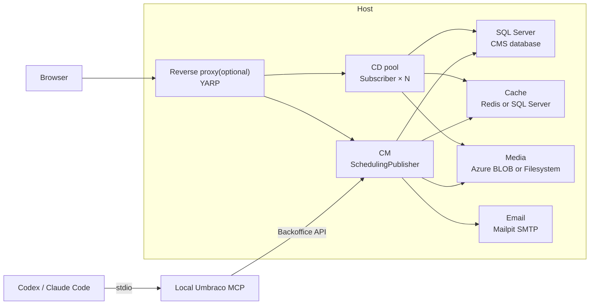

# Start your next Umbraco project with a working local topology

**One template gives your team content management, delivery, shared services, and local development tools.**

Your first day can produce a site you can show. Generate an Umbraco 17 solution with CM and a CD pool. Get SQL Server, cache, media, and local email in the same setup. Aspire starts the resources and shows their health. A published sample site gives you pages to inspect on first boot.

## Give your team a head start

- Publish content in CM. Check it through CD nodes that share the database and media store.
- Choose Redis or SQL cache. Choose Blob or filesystem media. Run with Docker or Podman.
- Add YARP when you need public CM and CD routes. 
- Inspect health and telemetry in Aspire.
- Connect Codex or Claude Code through local MCP after CM is ready.

Build content models, pages, and delivery rules on a setup your team can repeat. Show a working site while the ideas are fresh.

## See the topology



CD instances share the same database, cache, and media store. The example below selects Redis and Blob media.

## Show the work sooner

Start Aspire and watch the resources come online. Open the published sample site on CM and CD. Inspect test email in Mailpit and service health in the dashboard. When you change content, check the delivery path through the same local topology. Your team gets a clear starting point for demos, onboarding, and feature work.

## Get the template now

Install version `1.0.0`. Then use the annotated command below to generate your solution.

```bash
dotnet new install Casko.UmbracoTopology.Templates@1.0.0
```

```bash
# Set the template options.
template_options=(
  # Solution name and output folder.
  --name Example.UmbracoSite
  --output ./Example.UmbracoSite

  # Local SQL Server password.
  --sql-password 'Dev1234567890!'

  # Cache: redis or mssql. Media: blob or filesystem.
  --cache-provider redis
  --media-provider blob

  # Container runtime: podman or docker.
  --container-runtime podman

  # Local administrator credentials.
  --admin-email admin@cm.dev.localhost
  --admin-password '1234567890'

  # Local API user for MCP.
  --api-user-email apiuser@dev.localhost
  --api-client-id umbraco-back-office-example
  --api-client-secret '1234567890'

  # Run the template setup scripts.
  --allow-scripts Yes

  # Optional CM and CD ports. CD2 uses the next CD port.
  --cm-port 64222
  --cd-port 44222

  # Optional YARP reverse proxy, hosts, and port.
  --reverse-proxy
  --cm-domain cm.dev.localhost
  --cd-domain cd.dev.localhost
  --proxy-port 4443
)

# Create the solution.
dotnet new casko-umbraco-topology "${template_options[@]}"
```

The generated README gives you the run commands and local addresses. The [technical README](../README.md) covers certificates, Python setup, MCP, and verification.

**Install the template now. Generate your solution. Show the site you came to build.**
