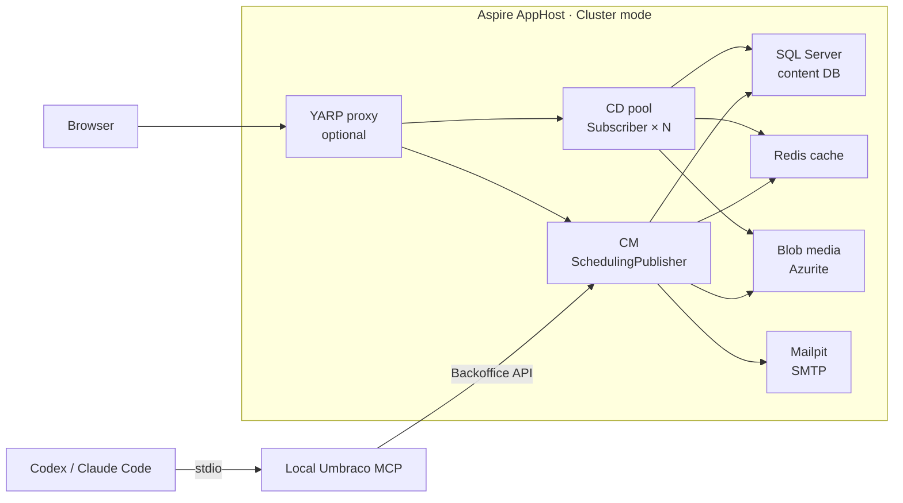

# Umbraco topology example

See the [technical README](../README.md) for installation, Python setup, MCP setup, and run commands.



CD instances share the same database, cache, and media store. Redis and Blob media are the shown options.

```bash
# Set the template options.
template_options=(
  # Solution name and output folder.
  --name Example.UmbracoSite
  --output ./Example.UmbracoSite

  # Local SQL Server password.
  --sql-password 'Dev1234567890!'

  # Cache: redis or mssql. Media: blob or filesystem.
  --cache-provider redis
  --media-provider blob

  # Container runtime: podman or docker.
  --container-runtime podman

  # Local administrator credentials.
  --admin-email admin@cm.dev.localhost
  --admin-password '1234567890'

  # Local API user for MCP.
  --api-user-email apiuser@dev.localhost
  --api-client-id umbraco-back-office-example
  --api-client-secret '1234567890'

  # Run the template setup scripts.
  --allow-scripts Yes

  # Optional CM and CD ports. CD2 uses the next CD port.
  --cm-port 64222
  --cd-port 44222

  # Optional YARP reverse proxy, hosts, and port.
  --reverse-proxy
  --cm-domain cm.dev.localhost
  --cd-domain cd.dev.localhost
  --proxy-port 4443
)

# Create the solution.
dotnet new casko-umbraco-topology "${template_options[@]}"
```
